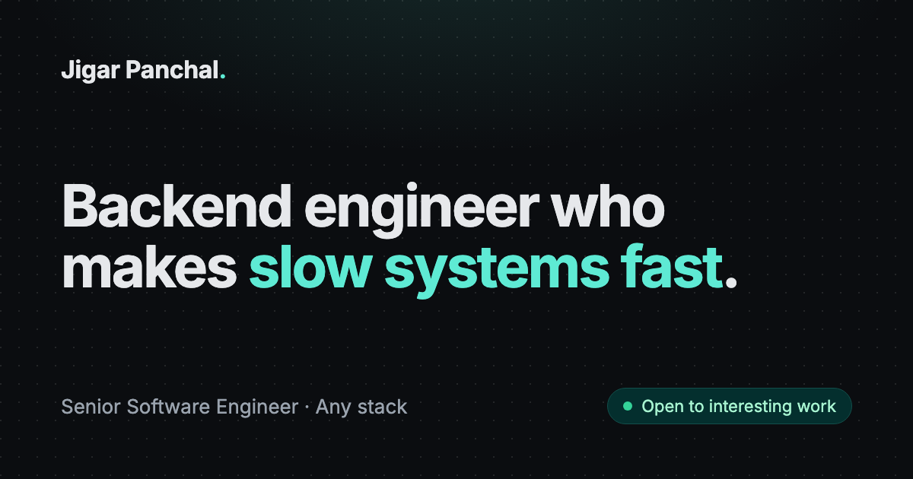

<div align="center">

# Jigar Panchal

**Senior Software Engineer · Backend**

[**jigar786.github.io**](https://jigar786.github.io)

[](https://github.com/jigar786/jigar786.github.io/actions/workflows/deploy.yml)



</div>

---

## About

My personal website: experience, projects and a way to get in touch. It's a single static page built to be fast, accessible and easy to keep up to date.

## Highlights

- **Fast:** static HTML and CSS, about 35 KB per page, no client-side framework.
- **Accessible:** semantic markup, keyboard and screen-reader friendly, WCAG AA contrast, respects *reduce motion*.
- **Responsive:** designed mobile-first and tested from 320 px phones to wide desktops.
- **Light and dark themes:** follows the system setting, with a toggle that remembers your choice.
- **Subtle motion:** a typing headline and scroll reveals, using CSS plus one tiny inline script.
- **SEO-ready:** Open Graph preview, JSON-LD `Person` schema, sitemap and robots.txt.

## Tech stack

| | |
|---|---|
| Framework | [Astro](https://astro.build) (static output) |
| Styling | Plain CSS with design tokens |
| Font | [Inter](https://rsms.me/inter/), self-hosted |
| Tests | Node's built-in test runner, run against the production build |
| Hosting | GitHub Pages via GitHub Actions |

## Project structure

```text
src/
├── data/profile.ts      ← all site content lives here
├── components/          ← one component per page section
├── layouts/Base.astro   ← <head>, SEO tags, theme + interaction script
├── styles/global.css    ← design tokens and shared styles
└── pages/index.astro    ← the page
public/                  ← favicon, social image, robots.txt
tests/                   ← checks for content, SEO, accessibility, privacy
```

## Getting started

Requires **Node 24+**.

```sh
npm install
npm run dev          # http://localhost:4321 (live reload)
npm run dev:phone    # HTTPS on your local network, for testing on a phone
npm test             # production build + all checks (run locally)
npm run preview      # serve the production build locally
```

## Updating content

Edit **`src/data/profile.ts`**, which holds the headline, stats, experience, projects, skills and links. Every section is generated from it.

To regenerate the social preview image (`public/og.png`) after design changes, run `npm run og` (requires Google Chrome).

## Deployment and branch protection

- **`main` is protected.** Direct pushes, force pushes and deletion are blocked for everyone, so changes land through pull requests.
- **Only the owner (@jigar786) approves and merges.** Every file is code-owned, so other people's pull requests need the owner's approval.
- **Nothing merges automatically.** Auto-merge is disabled, so a pull request lands only when the owner merges it.
- **Merging to `main`** triggers the deploy workflow, which builds the site and publishes it to GitHub Pages.

The owner merges their own pull requests with the admin override, which works only through a pull request and never as a direct push:

```sh
git switch -c update-content
# …edit, then:
git commit -am "Update experience"
git push -u origin update-content
gh pr create --fill
gh pr merge --squash --admin --delete-branch
```

## License

Code: MIT. Content, including text and images: © Jigar Panchal, all rights reserved.
